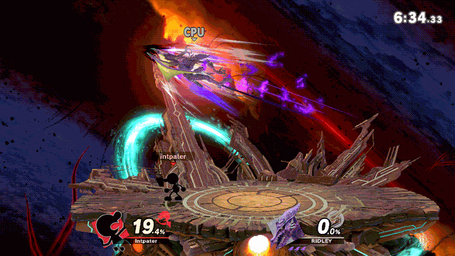

# ssbu-gnw-judge-log

> **Disclaimer:** this project was developed with the assistance of AI
> (Claude, Codex and other coding agents) under the operator's direction and
> review. Nothing is claimed beyond the dated tests cited below.

Skyline plugin for Super Smash Bros. Ultimate 13.0.5 that logs every Game &
Watch Judge: the number, what both players were doing, where they were, their
damage and whether their moves hit. After enough matches the log is a dataset
for asking when 9s come up. Only 1v1 matches with G&W are logged; without G&W
the plugin does nothing. Read-only: safe to leave on online.



*A 6 out of a dash that hits a CPU Ridley, logged below (Eden, 2026-10-29).*

## How it works

**1. Play G&W.** Each Judge becomes one row of `judges.tsv` (some of its 44
columns):

```text
number=6  excluded=5  last_number=5  judge_hit=hit
gw:  ground  19.5%  special_s_6  prev=dash (5 frames)  last_move=attack_s4 (none)
opp: ridley  ground  0.0%  landing_fall_special  distance=21.4
```

**2. Collect the log** from `sd:/ultimate/ssbu-gnw-judge-log/judges.tsv`.

**3. Make the table.** One CSV for any statistics tool, plus a first look:

```text
python3 tools/judge_table.py judges.tsv -o judges.csv
```

It keeps tournament-legal stages (the list is at the top of the script;
`--all-stages` keeps everything) and prints how often each number came up
and, per context (place, previous
move, hit or not, damage...), the 9s seen against what a fair draw gives. The
game never repeats the number it holds as the previous one (it forgets it when
G&W is KO'd), so a fair draw gives a 9 one time in 8.

## The 9 window

A Judge's number is fixed by the game's fighter RNG stream at the moment of
the draw (read from G&W's own script; [docs/HOOKS.md](docs/HOOKS.md)). The
plugin computes, every frame, what a side special started then would show:
the `predicted` column matched 80 of 84 Judges in Eden before they happened
(in the four misses another fighter's draw landed in the same frame first),
and `windows.tsv` records every state with its number and context.

The stream moves whenever fighter code draws from it, and each new state is
a fair pick. Over 15 Eden matches on Final Destination against CPUs (ten of
them under a tournament ruleset: 3 stock, items off, level 9; 12,948 states)
no context predicted a 9 beyond chance: 300 groups tested, none significant
after correction; the per-match 9 counts spread as a fair draw's do; what was
visible on the frame a state began on (a hit, a KO, a shield, a Judge,
nothing) made no difference. A replay of a human match (7,186 states) was
fair too.

```text
python3 tools/window_table.py windows.tsv
python3 tools/match_report.py <run folders>
```

How often the stream moves depends on the opponent: about 25 times a second
against most fighters, about once every 2 seconds against Yoshi, Mewtwo,
Lucas, Pichu and Pac-Man. The odds per state are the same either way.

What does hold, from the formula: 0 % right after a 9, 1/9 with nothing
excluded (first Judge of a match, after G&W is KO'd), 1/8 normally, 1/7 within
150 frames of a 7 hitting if your last Judge was not that 7.

## Install

Copy `libssbu_gnw_judge_log.nro` to
`sd:/atmosphere/contents/01006A800016E000/romfs/skyline/plugins/`. About 0.5 KB
of log per Judge.

## More

- [docs/FORMAT.md](docs/FORMAT.md): every column.
- [docs/HOOKS.md](docs/HOOKS.md): the hook, what it reads, why it is safe online.

## Build

```text
cargo test
cargo skyline build --release
```

## License

MIT
